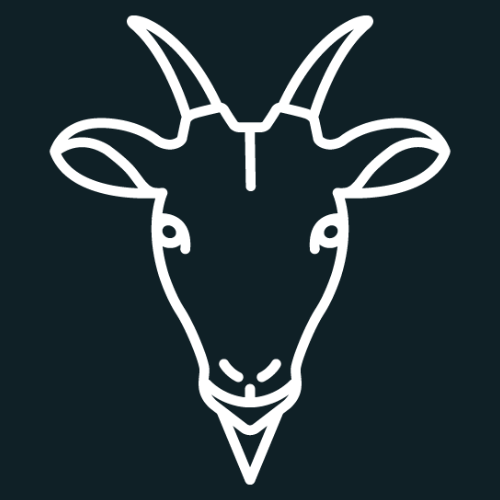

<h1 align="center"> KXLE — BOT - Bot Chat Messenger</h1>

	
  
  
  
  

- [📝 **Note**](#-note)
- [🚧 **Requirement**](#-requirement)
- [📝 **Tutorial**](#-tutorial)
- [💡 **How it works?**](#-how-it-works)
- [🔔 **How to get notification when have new update?**](#-how-to-get-notification-when-have-new-update)
- [🆙 **How to Update**](#-how-to-update)
- [🛠️ **How to create new commands**](#️-how-to-create-new-commands)
- [💭 **Support**](#-support)
- [📚 **Support Languages in source code**](#-support-languages-in-source-code)
- [📌 **Common Problems**](#-common-problems)
- [📸 **Screenshots**](#-screenshots)
- [✨ **Copyright (C)**](#-copyright-c)
- [📜 **License**](#-license)

## 📝 **Note**
- This is a messenger chat bot using a personal account, using an unofficial facebook api and this may lead to facebook account being locked due to spam or other reasons.
- So, I recommend using a clone account (one that you're willing to throw away at any time)
- ***I am not responsible for any problems that may arise from using this bot.***

## 🚧 **Requirement**
- Node.js 16.x [Download](https://nodejs.org/dist/v16.20.0) | [Home](https://nodejs.org/en/download/) | [Other versions](https://nodejs.org/en/download/releases/)
- Knowledge of **programming**, javascript, nodejs, unofficial facebook api

## 📝 **Tutorial**
- See [here](https://github.com/sykexyz/kxledummybot/blob/main/STEP_INSTALL.md)

## 💡 **How it works?**
- The bot uses the unofficial facebook api to send and receive messages from the user.
- When having a `new event` (message, reaction, new user join, user leave chat box,...) the bot will emit an event to the `handlerEvents`.
- The `handlerEvents` will handle the event and execute the command:
  - `onStart`:
    - the handler will check if user `call a command or not`.
    - if yes, it will check if `user banned` or mode `admin box only is turned on` or not, if not, it will execute the command.
    - next, it will check the `permission` of the user.
    - next, it will check if the `countdown` of command is over or not.
    - finally, it will execute the command and `log` information to the console.

  - `onChat`:
    - the handler will run `when the user sends a message`.
    - it will check `permission` of the user.
    - the handler will `execute` the command, if it return a `function` or `async function` then it willl check `user banned` or mode `admin box only is turned on` or not, if not, it will call the function and `log` information to the console.

  - `onFirstChat`:
    - the handler will run `when get the first message` from the chat box since the bot started.
    - the way it works is like `onChat`.

  - `onReaction`:
    - the handler will run when the user `reacts` to a `message has messageID`.
    - next, it will check `permission` of the user and `execute` if the user has permission and `log` information to the console.

  - `onReply`:
    - the handler will run when the user `replies` to a `message has messageID`.
    - next, it will check `permission` of the user and `execute` if the user has permission and `log` information to the console.

  - `onEvent`:
    - the handler will run `when the user has a new event` type `event` (new user join, user leave chat box, change admin box,...)

  - `handlerEvent`:
    - the handler will run `when the user has a new event` type `event` (new user join, user leave chat box, change admin box,...)
    - it will get all the eventCommand set in the event commands and run them.

## 🔔 **How to get notification when have new update?**
- Click on the `Watch` button in the upper right corner of the screen and select `Custom` and select `Pull requests` and `Releases` and click `Apply` to get notified when there is a new update.

## 🆙 **How to Update**
- Pull the latest changes from the repository.

## 🛠️ **How to create new commands**
- See [here](https://github.com/sykexyz/kxledummybot/blob/main/DOCS.md)

## 💭 **Support**
If you have major coding issues with this bot, please open an issue in the repository.

## 📚 **Support Languages in source code**
- Currently, the bot supports 1 language:
- [x] `en: English`

- Change language in `config.json` file
- You can customize the language in the folder `languages/`, `languages/cmds/` and `languages/events/`

## 📌 **Common Problems**

	

		📌 Error 400: redirect_uri_mismatch
	

	

 
	
1. Enable Google Drive API

	
2. Add uri <a href="https://developers.google.com/oauthplayground">https://developers.google.com/oauthplayground</a> to <b>Authorized redirect URIs</b> in <b>OAuth consent screen</b>
  
	
3. Choose <b>https://www.googleapis.com/auth/drive</b> and <b>https://mail.google.com/</b> in <b>OAuth 2.0 Playground</b>

	

		📌 Error for site owners: Invalid domain for site key
	

		

		
1. Go to <a href="https://www.google.com/recaptcha/admin">https://www.google.com/recaptcha/admin</a>

		
2. Add domain <b>repl.co</b> to <b>Domains</b> in <b>reCAPTCHA v2</b>

	

		📌 GaxiosError: invalid_grant, unauthorized_client
	

	

 
	

 
	

 
	
- If you don't publish the project in google console, the refresh token will expire after 1 week and you need to get it back.

	

		📌 GaxiosError: invalid_client
	

	

	
- Check if you have entered your google project client_id correctly.

	

		📌 Error 403: access_denied
	

	

	
- If you don't publish the project in google console only the approved accounts added to the project can use it.

## 📸 **Screenshots**
- ### Bot

	

 		Rank system
	

  - Rank card:
  

  - Rankup notification:
  

  - Custom rank card:
  

	

 		Weather
	

	

	

 		Auto send notification when have user join or leave box chat (you can custom message)
	

	

	

 		Openjourney
	

	

	

 		GPT
	

	

	

	

- ### Dashboard

	

 		Home:
	

	

	

	

 		Stats:
	

	

	

 		Login/Register:
	

	

	

	

 		Dashboard Thread:
	

	

	

 		Custom on/off:
	

	

	

 		Custom welcome message (similar with leave, rankup (coming soon), custom command (coming soon))
	

	

	

## ✨ **Copyright (C)**
- **KXLE — BOT**

## 📜 **License**

**ENGLISH**

- This project is provided as-is. Use at your own risk.
- Don't claim this source code as your own work without attribution.
- Do not monetize this source code (such as: buy and sell commands, buy and sell bots, call for donations, etc.).
